# System architecture

Proposed target architecture; shaded meaning is conveyed by labels rather than
assuming that components already exist. See project status for implementation scope.

```mermaid
flowchart LR
  Eye[Model-eye fixture first] --> Optics[Optical acquisition - proposed]
  Pneumatic[Characterized pneumatic stimulus - proposed] --> Eye
  Pressure[Stimulus transducer - proposed] --> Safety[Dedicated safety and timing controller - proposed]
  Safety --> Pneumatic
  Optics --> Sync[Synchronized raw acquisition - proposed]
  Pressure --> Sync
  Sync --> Quality[Quality gate and calibrated estimator - proposed]
  Quality --> Local[Local record and encrypted outbox - proposed]
  Local --> Gateway[Authenticated ingestion]
  Gateway --> Store[Metadata plus protected object storage - proposed]
  Store --> Report[Report assembly]
  Report --> Review[Assigned clinician review - proposed]
  Review --> Follow[Documented follow-up - proposed]
```

The existing Python simulator substitutes for acquisition and produces invented
values. SQLite illustrates server ingestion. HTML illustrates a review report.
No diagram arrow proves an implemented sensor, cloud deployment or clinical service.

## Component boundaries

| Component | Owns | Must not own |
|---|---|---|
| Independent safety/timing controller | Interlocks, bounded action, sampling trigger, shutdown | Cloud availability or clinical diagnosis |
| Application host | UI, raw capture, local processing, durable outbox | Sole mechanism preventing harmful activation |
| ML estimator | Versioned output within evaluated domain and rejection | Unreviewed calibration updates or treatment advice |
| Gateway/service | Identity, authorization, schema, deduplication, audit | Rewriting acquisition identity or hiding failed delivery |
| Clinician application | Assigned review, amendment, acknowledgement | Treating absent/rejected values as normal |

Timestamp source, clock uncertainty and synchronization must be recorded separately
from receipt time. Retain calibration/model identity even when a report is amended.
Define raw retention before data collection; a SHA-256 digest provides integrity
checking but does not authenticate the device or verify the underlying measurement.
