# AirTon product specification - baseline 2026-10-04

**First commercial target, confirmed by the founder:** home IOP monitoring for
patients already under a doctor's care. This is the product direction; clinical
design inputs and release claims still require formal review. Document state:
working baseline v0.2.0, not an approved medical-device specification.

## Product definition

AirTon is intended to let an enrolled patient collect eye-specific pressure
measurements at home and share a traceable history with the assigned care team.
The patient follows a clinician-defined monitoring plan. The device must guide
positioning, reject unsuitable acquisitions, and expose measurement quality,
time, calibration and device identity. The clinician interprets trends alongside
the patient's examinations and care plan.

The initial indication is pressure monitoring, not independent glaucoma
diagnosis, disease exclusion, medication adjustment or autonomous emergency
triage. Retinal image classification is a separate research module with separate
data, intended use, validation and release decisions. An external-eye camera
cannot be assumed to acquire usable fundus photographs.

Pressure alone does not establish or exclude glaucoma.
[NEI](https://www.nei.nih.gov/eye-health-information/eye-conditions-and-diseases/glaucoma/glaucoma-and-eye-pressure)
and [NICE NG81](https://www.nice.org.uk/guidance/ng81/chapter/Recommendations)
provide clinical context; they do not validate AirTon.

## Confirmed project baseline

The [2024 idea submission](../../research/sources/airton-sih2024-extracted.txt)
names SIH problem 1550, a home-use non-contact tonometer. The July 2025 deck
describes a Raspberry Pi block diagram, pump/valve, pressure and optical sensing,
bilateral concept and connected reports. The
[August 2025 pitch](../../research/sources/airton-pitch-2025-08-extracted.txt)
instead names Arduino/ESP32 and reports an approximately INR 7,000 prototype.
These are historical descriptions, not a reconciled as-built configuration.

Three [training notebooks](../../ml/notebooks/README.md), six Hugging Face app
source snapshots, two locally preserved Keras weight files and a
[React web application](../../apps/web/README.md) have now been recovered.
[September 2026 drawings](../../hardware/mechanical/design-history.md) add
device concept views, but do not provide dimensions, tolerances, optical paths,
pneumatic design or editable CAD. No paired AirTon/reference IOP dataset or
physical verification report was recovered.

## Users, environment and first workflow

| Actor | Responsibilities | Design implications |
|---|---|---|
| Patient / trained caregiver | Follow prescribed session plan, identify eye, position instrument, review acquisition status, request support | Low-vision access, simple instructions, nonvisual feedback, recoverable failures |
| Treating ophthalmologist | Decide eligibility and schedule; train and assess competency; review history; set individualized escalation instructions | Assigned access, configurable care plan, complete failure and quality history |
| Service team | Provision, inspect, calibrate, repair and replace devices | Serial/lot records, controlled calibration, quarantine and service history |
| Clinic administrator | Manage enrolment and care-team assignment | Cannot infer clinical authority from an admin role |
| Manufacturer / quality lead | Control design, risk, production, complaints and releases | Traceable records, review responsibilities, change impact assessment |

Proposed initial population: adults able to operate the instrument or supported
by a trained caregiver, with an existing care relationship. Specific exclusions,
post-surgical restrictions, corneal conditions, visual/dexterity requirements and
paediatric scope remain clinical design decisions. They are not guessed here.

Home assumptions to verify include variable lighting, dust, unreliable network,
power interruption, vibration, incorrect storage, shared household devices,
language variation and users who cannot read a small display. FDA's
[home-use design guidance](https://www.fda.gov/regulatory-information/search-fda-guidance-documents/design-considerations-devices-intended-home-use)
is a useful design reference, not Indian authorization.

1. Clinic enrols the patient and assigns a device, training record and care plan.
2. Patient confirms identity and the selected eye.
3. Device checks readiness: calibration, battery, sensing, alignment and internal
   faults. A failed check prevents acquisition.
4. Device acquires the stimulus and response under independent safety controls.
5. Quality assessment accepts or rejects the acquisition. A rejection produces a
   reason and no pressure value. Retry instructions are bounded by the reviewed
   protocol.
6. Accepted eye-specific measurements and the full session record enter a
   durable local queue. An offline session remains visible locally.
7. Synchronization preserves measurement IDs; the server acknowledges durable
   receipt. Failure cannot appear as successful delivery.
8. Clinician reviews trends and acquisition failures. Amendments preserve the
   original observation and author/time.
9. Patient follows the pre-existing care instructions. New decisions remain with
   the treating clinician.

Measurement schedule, averaging rule, acceptable attempts, thresholds and
clinical response times must come from a reviewed care plan. Defaults are null
in [home-monitoring configuration](../../config/home-monitoring.json), not
numerical values copied from a synthetic demonstration.

## Architecture and interfaces

```mermaid
flowchart LR
  E[Eye and positioning] --> S[Sensing and alignment]
  S --> C[Independent acquisition controller]
  C --> Q[Signal quality and calibrated IOP estimation]
  Q --> D[Local display and encrypted outbox]
  D --> G[Phone or device gateway]
  G --> A[Authenticated ingestion]
  A --> P[Observation and provenance store]
  P --> W[Assigned clinician review]
  W --> R[Care plan and review record]
```

The independent controller owns timing, watchdogs, energy/exposure limits and
safe shutdown. Linux, phone UI, cloud or model output cannot bypass its controls.
Hardware feasibility starts with one measurement channel and model-eye benches;
bilateral simultaneous acquisition remains a later design option.

The gateway may be phone-assisted BLE or direct Wi-Fi. Select it using usability,
connectivity, battery, provisioning and support evidence. MQTT/HTTPS are transport
options; IoT connectivity is not proof of durable delivery, security or clinical
usefulness. See [cloud architecture](../cloud/architecture.md) and
[operations](../cloud/operations.md).

The synthetic API in src/airton is a tested contract example. Its random pressure
values and demonstration calibration IDs must never enter a real monitoring
record. Legacy Flask/FastAPI/Node implementations are reference history, not an
approved server.

## Design inputs to resolve before design freeze

| Group | Needed input | Current disposition |
|---|---|---|
| Clinical performance | Reference method, range, allowable bias/limits, repeatability and subgroup criteria | Not approved |
| Pneumatics | Nozzle geometry, distance, waveform, maximum stimulus/exposure and independent limits | Unspecified |
| Optical metrology | Observable, wavelength/exposure, frame/ADC rate, timing and uncertainty | Feasibility work required |
| Home use | Critical tasks, training, positioning, supported users and environmental limits | Planned; no completed home-use study |
| Form factor | Mass, footprint, display, battery/runtime, cleaning and transport | Concept drawings only |
| Data | Measurement/session contract, provenance, quality reasons, clock trust | Synthetic example exists; real schema to review |
| Service | Calibration interval, allowable drift, checks, warranty and replacement | No evidence-based interval |
| Economics | Landed BOM, yield, calibration labour, support/cloud/service and patient affordability | Historical budgets conflict |
| Release | Regulatory pathway, labeling, production controls and benefit-risk acceptance | All device release gates open |

Engineering targets may be proposed in design reviews, but every safety or
clinical limit needs a rationale, review and associated verification procedure.
[Requirements](requirements.md) and the
[design record index](../quality/design-record-index.csv) are the traceability spine.

## Verification and validation sequence

First demonstrate that the sensor observes a repeatable physical event at a
known model-eye reference pressure. Establish uncertainty and confounders
before fitting a complex estimator. Then verify independent controls and
fault responses on bench fixtures. Follow with authorized supervised comparator
and repeatability studies, then representative lay-user/home-environment
validation. Validate the complete device-to-doctor pathway separately from
individual software functions.

An office agreement result does not prove that a patient can safely position
and operate the device at home. A dashboard screenshot does not prove delivery
or care-team response. A fundus benchmark does not calibrate a tonometer.
The [home validation plan](../clinical/home-monitoring-validation.md) defines
these work packages and study records.

## Business model and release boundary

Evaluate both device purchase and clinic-managed rental/loan pathways. Rental
may improve affordability but introduces cleaning, turnaround, calibration,
loss and replacement costs. Collect attributable willingness-to-pay and
service-capacity evidence before selecting pricing. Historical deck forecasts
are retained as forecasts in [business reconciliation](../business/baseline.md).

The first release should be a controlled home-monitoring system with named
care-team responsibilities, patient training, service capacity, approved labeling
and relevant authorizations. There is no verified incorporation, patent filing,
commercial sale, clinical approval or clinical launch record in the recovered
evidence. These states remain explicitly unverified, not assumed absent forever.
