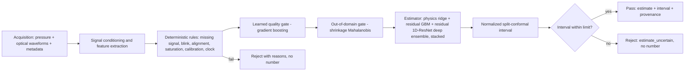

# Phase 0.3 plan: production-grade ML engineering baseline

**Date:** 2026-11-23. **Status:** implemented in v0.3.0; outcomes in the
[verification record](../../software/verification.md) and [changelog](../../../CHANGELOG.md).
**Evidence level of all model outputs:** synthetic-generated. Nothing here is
bench-measured, clinical or released. See [project status](../status.md).

## 1. Engineered prompt (as interpreted from the founder's request)

> **Role:** senior ML / medical-device software engineer working in the AirTon
> repository under [AGENTS.md](../../../AGENTS.md).
>
> **Context:** AirTon's first commercial direction is home IOP monitoring under a
> doctor's care. The current ML code is a two-feature linear regression on
> artificial data, and the retinal notebooks contain 13 audited defects
> ([audit](../../../ml/recovered-model-audit.md)). No paired AirTon/reference
> dataset exists. No hardware actuation is implemented.
>
> **Objective:** take the ML workstream to the next phase. Replace the toy
> exercise with a state-of-the-art, production-engineered IOP estimation stack
> that will accept real bench data unchanged once it exists, and rebuild the
> retinal research track as a corrected, governed training framework.
>
> **Must:** (1) keep pressure estimation separate from glaucoma risk and
> clinician interpretation; (2) reject unsuitable acquisitions with no number;
> (3) split by subject, with a held-out device domain and a final test used
> once; (4) quantify uncertainty with valid coverage, detect out-of-domain
> input and abstain; (5) report clustered agreement, not just accuracy;
> (6) avoid pickle and verify every artifact hash before loading; (7) be
> deterministic, versioned and covered by tests and CI; (8) update the
> requirements, risks, registries, model cards, verification and status records.
>
> **Must not:** invent clinical results, calibration, approved limits or
> accuracy claims; download datasets or deserialize recovered weights; execute
> recovered notebooks; modify `legacy/` snapshots; call synthetic scores
> clinical performance.
>
> **Done when:** the full unit suite, repository checks, demo and both training
> pipelines pass locally; generated model cards state synthetic status; every
> documentation change is linked and traceable.

"Ready for final production" is read as **software production readiness**:
reproducible, tested, safely serialized, versioned and portable. Clinical
production needs bench, safety, clinical and regulatory gates that no code
change can close ([roadmap](../roadmap.md)).

## 2. Architecture

Training uses torch and LightGBM. **Inference is numpy-only**: trees and the CNN
are exported to JSON/NPZ and evaluated by portable code, so a gateway or device
host needs neither native ML library nor pickle. Parity tests check that the
exported runtime matches the training libraries.

## 3. Work packages

| WP | Deliverable | Location | Requirement / hazard |
|---|---|---|---|
| WP1 | Physics-informed synthetic acquisition simulator (dynamic bidirectional applanation, corneal viscosity/stiffness, alignment, blink, flicker, saturation, device and calibration variation, held-out external devices) | `src/airton/ml/acquisition.py` | R04, R16; H03, H06, H09 |
| WP2 | Signal conditioning, applanation event detection, versioned feature set | `src/airton/ml/features.py` | R03, R04 |
| WP3 | Deterministic rules plus learned quality gate with recall-targeted threshold | `src/airton/ml/quality.py`, training | R03; H06 |
| WP4 | Estimators: physics ridge, residual LightGBM, residual 1D-ResNet heteroscedastic deep ensemble, cross-fitted stacking | `src/airton/ml/models.py`, `deep.py` | R08, R16 |
| WP5 | Uncertainty and abstention: normalized split conformal (one score per subject), OOD detector | `models.py` | H09; R13 |
| WP6 | Agreement metrics: clustered Bland-Altman, subject-bootstrap CIs, proportional bias, repeatability, range bins, coverage, rejection and leakage | `src/airton/ml/metrics.py` | R08, R16 |
| WP7 | Safe bundle format (hash-verified JSON/NPZ, no pickle), numpy runtime, contract-valid records | `bundle.py`, `runtime.py` | R05; H10, H13 |
| WP8 | Config-driven training pipeline, model card and run manifest generation; CLI and scripts | `training.py`, `scripts/train_iop_model.py` | R16, R19 |
| WP9 | Corrected retinal research framework (governed manifest, patient-grouped splits, single-logit loss, validation-only selection, temperature scaling, frozen threshold, clustered CIs) | `src/airton/ml/retinal/` | R01, R16, R17; H04, H09 |
| WP10 | Tests, CI, contract reason additions, records (requirements, risks, registry, cards, verification, status, backlog, ADR-003, changelog) | `tests/`, `docs/`, `models/` | R19 |

## 4. Explicit non-goals and open gates

- No physical-signal model is trained on real data. The synthetic simulator is
  an engineering harness. Its parameters are development assumptions, not
  measured AirTon behaviour, and must be replaced or fitted using bench evidence
  ([AT-005](../backlog.md), [AT-012](../backlog.md)).
- Rule limits, the quality recall target and the maximum interval width are
  *synthetic development settings*. They are not approved safety or clinical
  limits; `config/home-monitoring.json` still holds null clinical values.
- No public dataset is downloaded. The retinal framework refuses a manifest
  whose governance block is not completed.
- Web dashboard, production outbox, identity and cloud remain separate backlog items.
